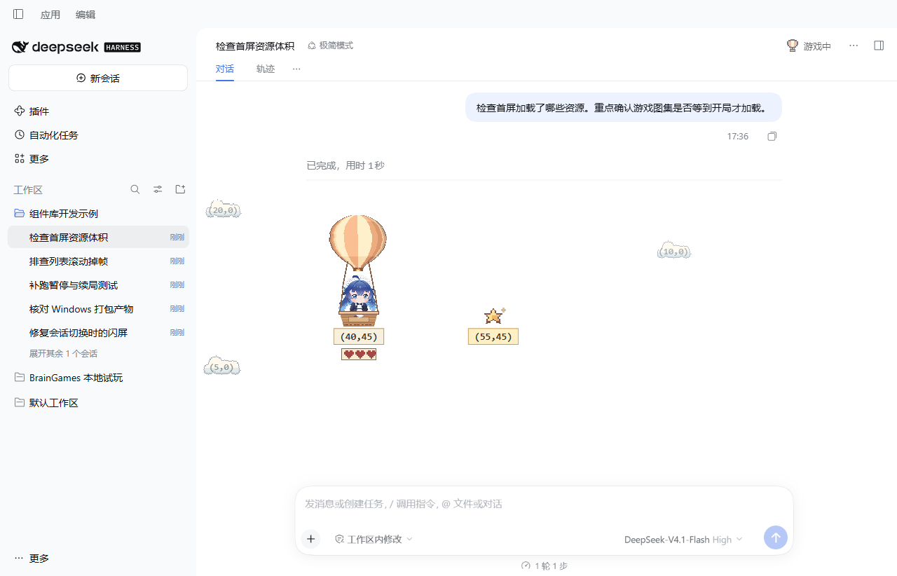
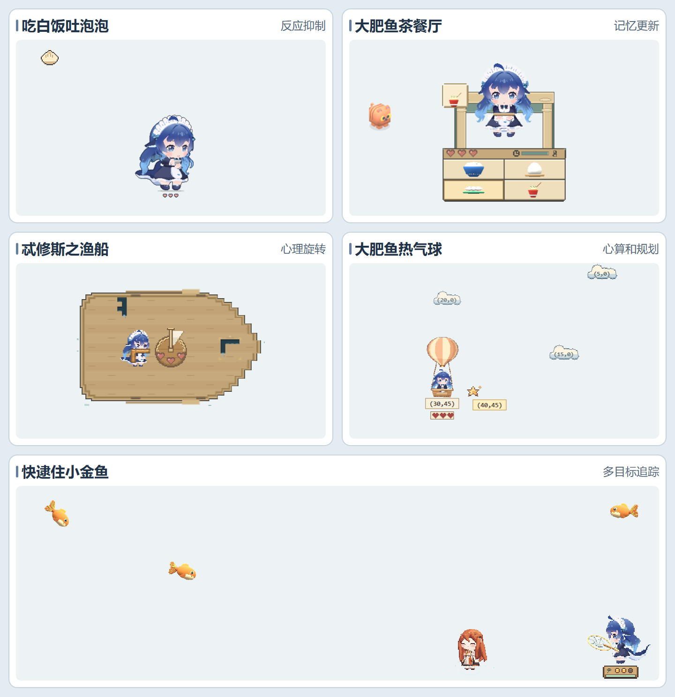

<div align="center">

<h1>dsh-braingames</h1>

<p>Play a few minutes of pixel-art cognitive training while your agent works.</p>

<p><a href="./README.md" lang="zh-CN">简体中文</a> · <strong>English</strong></p>

<p>
  <a href="#install"></a>
  <a href="https://github.com/hmhm2333/dsh-braingames/blob/HEAD/LICENSE.txt"></a>
</p>

<p>
  <a href="#games-and-training-goals">Games</a> ·
  <a href="#install"><strong>Install</strong></a> ·
  <a href="#settings">Settings</a> ·
  <a href="#why-cognitive-training">Why cognitive training?</a> ·
  <a href="#about-me">About me</a> ·
  <a href="https://github.com/hmhm2333/dsh-braingames/issues">Report an issue</a>
</p>

</div>

**Let the agent work, play a few rounds, then get back to the task. Pick up where you left off whenever you have a moment.** Games run over the DSH workspace. Click an empty area to use the workspace underneath.

<p align="center">
  
  <br />
  <sub>DeepSeek-chan’s Balloon running in a sample DeepSeek Harness workspace</sub>
</p>

## Games and training goals

DeepSeek-chan is the whale girl fans also call [Blue Dafeiyu](https://xn--pssy23gqgbz2d718b.com/en/about.html).

<p align="center">
  
</p>

| Game | Main cognitive skills | What you do |
| --- | --- | --- |
| **Rice & Bubbles** | Response inhibition, selective attention | Press Space to catch food. Skip empty bubbles, food in bubbles, and food shown on the red card. The time to decide gets shorter. |
| **DeepSeek-chan's Café** | Working memory updating, spaced recall | Wait for the guest to stop. Remember any new order. When a regular gives no new order, serve their last order. More guests join as you play. |
| **Theseus's Boat** | Visuospatial representation, mental rotation | Picture the plank rotated and choose the matching gap. Later rounds have trickier shapes and more gaps to choose from. |
| **DeepSeek-chan's Balloon** | Mental arithmetic with signed numbers, planning several moves ahead | Left click to add a cloud’s offset. Right click to subtract it. Ride the clouds to the star. Later levels take more moves. |
| **Catch Claude-chan!** | Tracking several targets, remembering arrival order, prioritizing actions | Watch when each fish arrives. When the net is ready, scoop the fish that has been there longest. Lose a light whenever a fish turns into Claude-chan. |

In **Catch Claude-chan!**, the first group arrives together. Watch the ordinary fish swim away safely. After scooping a fish, wait for the net to be ready again.

## Install

The current public release is `1.1.0`. It requires **DeepSeek Harness `0.2.2-rc.1` or later** (`>=0.2.2-rc.1`).

In DSH, open **Plugins → Add plugin**, select the npm registry, and enter the following package name. [npm package](https://www.npmjs.com/package/dsh-braingames)

```text
dsh-braingames@1.2.0
```

If you have the `dsh` command configured, choose the command for your client.

**Desktop client** (use the `dsh` command registered by the client)

```bash
dsh plugin --profile desktop add dsh-braingames@1.2.0
```

**Standalone Web**

```bash
dsh plugin --profile web add dsh-braingames@1.2.0
```

You can also paste the GitHub package URL into **Add plugin**. [Release notes](https://github.com/hmhm2333/dsh-braingames/releases/tag/v1.2.0)

```text
https://github.com/hmhm2333/dsh-braingames/releases/download/v1.2.0/dsh-braingames-1.2.0.tgz
```

Or use the Git URL pinned to the same version.

```text
git+https://github.com/hmhm2333/dsh-braingames.git#v1.2.0
```

After installing, open a conversation and click the **game icon to the left of the file button in the task header**. You can start a game while idle, too.

### Build from public source

Run these commands from the root of the public repository. The build was verified with Node.js `22.22.0` and npm `10.9.4`.

```bash
npm ci --ignore-scripts
npm run build
npm pack --ignore-scripts
```

Git installs use the prebuilt `lib/` in the repository. Rebuild it after changing the source.

## Settings

Open **Plugins → dsh-braingames** in DSH.

Games follow your DSH display language. The current round keeps its language through the results screen. The next round uses the new language.

| Option | How it works |
| --- | --- |
| **Game pool** | New rounds use the games you select. Select at least two to switch games after a round. |
| **Automatic invitations** | You can show invitations only while a task is running or pause them when a completion alert is unread. |
| **Model recommendation** | Games are picked at random on this device by default. With this on, DSH uses its default model for the first pick when several games are available. |
| **Return to work** | The game is hidden by default. Resume from the task header. You can also keep the paused game visible and click DeepSeek-chan to resume. |
| **After refreshing** | You can keep the round for the current DSH run. |

Model recommendations may send up to 10 recent main conversation titles, up to 64 UTF-16 code units each. Charges may apply. The game waits up to 5 seconds before picking at random. **Try another** on the results screen always picks at random on this device.

Best scores are stored in the client or browser on this device. The options above control pausing and resuming after a refresh.

**View personal bests** shows each game's top 10 scores for its current rules. Best scores from 1.0.0 still appear on the results screen. Open **Record backup** to export or restore local round scores and compressed decision records. Import skips records you already have.

### Agent challenge

A colleague suggested a slightly unforgiving rule. **Miss the score goal, and your next task has to wait.** The ship repair game defaults to **60 planks**. Finish with **59**, and new tasks are paused. Meet the goal in whatever game you play next, or turn the challenge off to resume.

The switch is at the bottom of the `dsh-braingames` plugin details page and is off by default. Every game has an adjustable target. The other defaults are 30 café orders, 150 seconds in Rice & Bubbles, 20 balloon stars, and 150 seconds in the goldfish game.

- **Current DSH** pauses sending in DSH while running tasks continue. Your draft stays in the input box. Click the locked box to open a centered pixel-art window with the last score and its target.
- **Connected agents on this device** also covers connected clients on Windows, including Codex desktop and CLI, Claude Code, and Cursor. When you submit a new task, their hooks check the challenge status with the running DSH instance.

Select **Connect** to add the BrainGames hook alongside any existing hooks in the client's user configuration. For Codex, trust the entry whose command includes `agent-submit-hook.mjs` in **Settings → Hooks** on desktop or `/hooks` in the CLI. Submit a test task in that client, then select **Refresh connection status** in the plugin. **Hook ran successfully** confirms that DSH received the check.

## Why cognitive training?

Cognitive training makes a mental process into a task you can repeat, such as stopping an action you are about to take or replacing information you just remembered. Progress on the training task, progress on a related test, and benefits in everyday life each need to be verified separately.

**Cognitive aging and maintaining skills.** In the randomized ACTIVE trial, older adults who received reasoning or processing-speed training still showed effects on their respective trained skills ten years later.

**Dementia risk.** The WHO’s 2026 guidance includes cognitive training and stimulation among recommendations for reducing dementia risk in adults with normal cognition or mild cognitive impairment. The 20-year ACTIVE follow-up found fewer dementia diagnoses among older adults who completed a specific speed-of-processing program with booster training than in the control group. Later reanalysis suggests that the results depend on the statistical method. Scores in dsh-braingames describe performance in that round. Medical and long-term health effects require separate evidence.

**How to practice.** As in a workout, pick a skill, repeat the task with feedback, and build up the difficulty. That might mean remembering more customers or answering more quickly. Finish a short set while the agent works, then get back to the task.

## About me

I’m Hengheng.

- I designed cognitive training for children ages 3 to 12 at a **leading education technology company**. The training reached many students through products used in classrooms and supported preparation classes for the High School Affiliated to Renmin University of China’s 早早培 and 早培 programs and Beijing No. 8 High School’s 八素八少 programs.
- At a **leading brain science company**, I designed targeted cognitive training for children, adults, and older adults. The projects included clinical trials. Cognitive training assessments and products I helped develop received **Class II medical device registrations** in China. The project’s AI digital therapeutics approach was submitted for consideration in preliminary work on Class III medical device standards.
- I now combine learning development and cognitive training in hands-on education services and build **learning games for parents and children**.

## License

Original code is licensed under MIT. Fonts and other third-party assets are distributed under their respective licenses. [MIT license](https://github.com/hmhm2333/dsh-braingames/blob/HEAD/LICENSE.txt) · [Third-party notices](https://github.com/hmhm2333/dsh-braingames/blob/HEAD/THIRD_PARTY_NOTICES.md)
